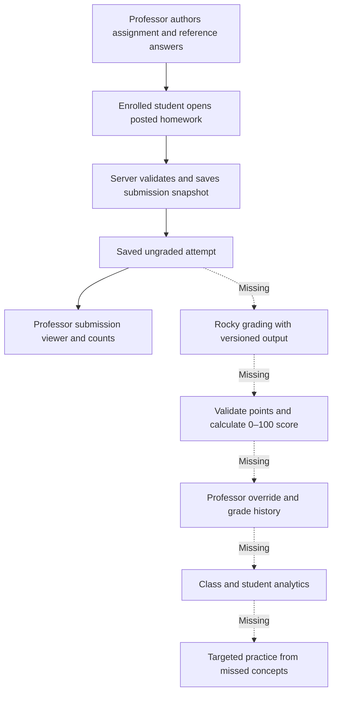

# Product audit — Philosophy classroom

**Date:** October 26, 2026 (America/New_York)  
**Starting revision:** `e9bd14c`  
**Scope:** Product requirements, application code, authentication/authorization, MongoDB persistence and metadata, Rocky integration, UI/navigation, dependencies, development configuration, documentation, and automated tests.

## Assessment

The app is a working coursework prototype, but it does **not yet satisfy the full intended product**. Students can register, be enrolled, open published homework, submit answers, and review saved attempts. Professors can manage enrollment, author assignments and problems, and enter class-level grades. The central missing workflow is **submission → Rocky grading → validated 0–100 grade → professor override → dashboard aggregates → targeted practice**.

This audit includes implementation changes: a substantial Streamlit UI/navigation redesign, corrected submission visibility/counting, authentication/configuration fixes, and regression tests. It does not implement the missing grading engine or turn every requirement into a completed feature. The findings below distinguish completed changes from remaining work.

All changes retain Streamlit, MongoDB, and Kent State's Rocky. No paid AI, hosting, domains, or external font services were added. The preexisting optional public-web search remains, now requiring explicit submission.

## Evidence and limits

| Check | Result |
| --- | --- |
| Starting worktree | Clean; changes listed here were made during this audit. |
| Baseline suite | **194 tests passed**, **84% line coverage**. |
| Final suite | **216 tests passed**, **87% line coverage**; coverage and JUnit reports regenerated. |
| Local runtime | Python **3.14.8**, Streamlit **1.63.0**, PyMongo **4.18.1**. CI targets Python **3.12**; the devcontainer now matches CI. |
| Dependency consistency | `python -m pip check` passed. This is not an advisory/CVE scan or a reproducible clean-environment install. |
| Script syntax | `node --check docs/assignment-validation.js` passed. |
| Patch hygiene | `git diff --check` passed. |
| Rocky discovery | Authenticated `GET https://rocky.cs.kent.edu/v1/models` returned HTTP **200**, advertising **`qwen3.8-27b`**. This verifies model discovery at audit time, not grading quality or inference reliability. |
| MongoDB | Connectivity succeeded. Collection options and index definitions were inspected read-only. No student answers, account documents, or grades were read for the live metadata audit. |
| Live mutations | No live database writes, schema migrations, account changes, or model inference requests were performed. |
| UI verification | Streamlit AppTest exercised page navigation, forms, role guards, submission/privacy flows, and failure paths. Browser rendering, mobile layouts, screen readers, and live end-to-end acceptance were not verified. |
| Security scope | Source/configuration review and regression checks; not a penetration test, infrastructure audit, complete Git-history secret scan, or formal privacy/compliance review. |

The local test suite blocks live HTTP and MongoDB access. Its mocks verify application behavior, not deployed MongoDB validation or real Rocky responses. Coverage is line coverage, not proof of requirement completeness.

## Requirement coverage after this audit

| Requirement | Status | Evidence / remaining limitation |
| --- | --- | --- |
| Use Streamlit | Implemented | All UI remains Streamlit. The native theme and `st.navigation` drive the redesign. |
| Keep MongoDB | Implemented | All persistent application data still uses MongoDB. |
| Use Kent State Rocky | Partially implemented | Student assistant uses the Kent endpoint; current model verified as `qwen3.8-27b`. Homework grading is not connected. |
| Avoid paid outside services | Preserved by these changes | No new paid provider or hosting dependency. Existing deployment billing was not reviewed. |
| Create accounts | Partial | Public student registration and login work. Professor provisioning is a manual database operation; account edit/delete/reset flows are absent. |
| Assign accounts to classes | Implemented for existing classes | Current instructor can enroll/remove existing students. Unique enrollment index exists in the inspected database. |
| Create/read/update/delete classes | Incomplete | Class listing, roster management, and class grades exist. Class creation, editing, archive/delete workflows, and associated lifecycle rules are absent. |
| Assignment/homework CRUD | Substantially implemented | Create, list, edit, publish, close/reopen, delete, and scheduling exist. Class reassignment, version conflicts, and retention behavior need work. |
| Problem CRUD | Implemented with limitations | Embedded short-answer questions support add/edit/delete and stable IDs for current-format data. Last-problem deletion is blocked; reordering and other problem types are absent. |
| Take assignments | Implemented | Dedicated list and taking pages; server checks student role, enrollment, visibility, exact answer IDs, and nonblank answers. |
| Advanced characters | Basic text support; richer requirements pending | Unicode and literal LaTeX survive persistence; prompts use Streamlit rendering. No specialized symbol editor/parser or semantic proof checker exists. Exact character/editor requirements remain unspecified. |
| Compare answers to professor's answer | Missing integration | Private reference answers and grading guidance are stored and included by `build_grading_payload`; the submission flow does not call that builder or Rocky. |
| Grade 0–100 | Missing | Submissions remain `ungraded`; the separate completion helper accepts nonnegative points without a 100-point cap. |
| Professor grade override | Partial, wrong granularity for the requirement | Instructor can edit class enrollment points. There is no assignment/submission AI-grade override or override history. |
| Dashboard averages, grades, submissions | Partial, improved here | Actual submission counts and manual student class grades are now visible. Assignment averages, AI grades, distributions, missing-student counts, and topic performance are absent. |
| Generate practice from missed problems | Missing | Weakness analyzer exists separately; recommendation module is empty. Practice page now explains the missing feature rather than showing an empty page. |
| Complete UI overhaul | Implemented in source; acceptance pending | Consistent academic theme, sidebar navigation, new login layout, real student overview, metric cards, account page, and editor tabs. Browser/accessibility acceptance remains to do. |
| Separate assignment creation/taking pages | Implemented | Creation and editing have separate professor routes. Existing separate student homework/taking routes are preserved and exposed through navigation. |

## Current and intended data flow



The student Rocky conversation is a separate interaction. It is not currently a grader. `completed_assignments` is a separate legacy/trusted completion path; normal homework submission never writes to it.

## Findings fixed or addressed in this pass

Severity describes the original impact. UI work is included because it was explicitly requested.

| ID | Severity | Finding and completed change |
| --- | --- | --- |
| A01 | High | **Login could crash before its database error handling.** `use_attempt` and successful-login counter cleanup were outside protected paths. Both now return the generic unavailable message on database/runtime failure. No session is granted on cleanup failure. Tests exercise both paths and the actual login page. See [authentication](../app/auth/auth.py). |
| A02 | High | **Missing MongoDB secrets escaped as configuration exceptions.** The lazy connection now translates missing secret/key failures into `RuntimeError`, which callers handle. Selection/connect timeouts are bounded to five seconds. Runtime/query/load performance still needs separate attention. See [database helper](../app/db/DataBase.py). |
| A03 | High | **Professor submission counts used the wrong collection.** Normal student answers were written to `homework_submissions`, but dashboard counts came from `completed_assignments`. Counts now include saved ungraded homework attempts, with distinct-student and attempt totals. See [submission helpers](../app/db/homework_submissions.py) and [professor dashboard](../app/pages/dashboards/professor.py). |
| A04 | High | **Professor submission table could not show the work students actually submitted.** The editor now reads real homework attempts, shows ungraded status and timestamps, and lets the professor review saved answers and snapshot references. The new reader checks assignment ownership and the current class instructor before returning private work. Legacy completions remain stored and their helpers remain available. |
| A05 | Medium | **Assignment lookup did not normalize string IDs.** Session IDs can be strings, while MongoDB `_id` is an ObjectId. `get_assignment` now converts/validates the ID before querying. See [assignment helpers](../app/db/assignments.py). |
| A06 | Medium | **A missing ID could generate a new random ObjectId.** `ObjectId(None)` generates an ID instead of rejecting input. The shared ID validator now rejects unsupported types before construction. This was an input-validation defect, not a demonstrated login bypass. |
| A07 | Medium | **Professor/student deadline status disagreed.** The professor dashboard added 24 hours to every stored deadline; the student page used the stored timestamp. Both now use the stored UTC deadline. Date-only authoring remains midnight UTC at the beginning of the chosen date, and this is stated in form help. A better local date-and-time UX remains open. |
| A08 | High | **Streamlit secrets were not explicitly Git-ignored.** `.streamlit/secrets.toml` and local `.env.*` variants are now ignored; `.env.example` remains trackable. No existing tracked secrets were found in the current tracked-file list, but this is not a full history scan. |
| A09 | High | **Development launch disabled CORS and XSRF protections.** Removed `--server.enableCORS false --server.enableXsrfProtection false`. Devcontainer uses the default protections and Python 3.12 to match CI. This does not certify reverse-proxy/TLS configuration. |
| A10 | Medium | **Long, inconsistent navigation and placeholder screens.** Added explicit role-scoped sidebar navigation and dedicated creation/editing/classes/account/practice routes. Editor has Details, Problems, and Submissions tabs. Removed unused query-parameter placeholder sections and fake “recently visited” cards. Students retain separate homework-taking pages. |
| A11 | Medium | **Student overview lacked real coursework/grade data.** Replaced placeholders with actual enrollment, manual class grades, pending coursework, submitted-attempt counts, and awaiting-grading counts. The overview helper returns selected public assignment fields, excluding answer keys/snapshots. Grades are labeled as points recorded by the professor, not invented AI results. |
| A12 | Medium | **Public-web search reran on unrelated interactions.** Search now runs only on explicit form submission and retains results in the session. It explains that the query goes to an external service. Results use HTTP(S) link buttons rather than interpolating provider output into Markdown links. The service remains optional and separate from homework. |
| A13 | Medium | **Some professor errors exposed raw persistence exceptions.** Creation, editor, and dashboard now show generic messages for database/runtime errors while retaining field-validation messages. Detailed failures are logged server-side. Student homework already used generic persistence errors. |
| A14 | Medium | **Dependencies were unbounded and Rocky relied on transitive `requests`.** Added supported version bounds and an explicit `requests` dependency. Minimum Streamlit is 1.63 for APIs used in the UI. A lockfile and advisory scanning remain open. |
| A15 | Usability | **First-question grading fields were unavailable during creation.** The creation form now includes points, topic, private reference answer, and private grading guidance, and stores those structured fields. Added Unicode/LaTeX input guidance. Reference fields remain optional because grading is not yet connected. |
| A16 | Usability | **Global CSS forced centered text, oversized buttons, and conflicting student styling.** Replaced both stylesheets with a native warm-paper/navy academic theme, serif headings, consistent controls, metric cards, and built-in fonts. Removed the scrolling placeholder iframe/JavaScript. Actual browser appearance remains an acceptance item. |

## Remaining findings and product decisions

“Missing” means no implementation was found. “Risk” means the code permits the scenario; it does not imply that it has happened in the deployed data.

| ID | Priority | Finding, evidence, and next action |
| --- | --- | --- |
| B01 | P0 | **No automated grading pipeline.** [Submission writer](../app/db/homework_submissions.py) only writes `ungraded`; [payload builder](../app/homework/schema.py) is unused by that flow. Implement a Rocky-only grading service, validated output, durable result/failure state, and retry behavior. Do not send every answer as a generic chat question. |
| B02 | P0 | **No canonical 0–100 grade contract.** [Completion helper](../app/db/completed_assignments.py) accepts any finite nonnegative number, including values above 100. [Class-grade helper](../app/db/DataBase.py) accepts earned points above possible points. Establish points versus percentages, rounding, extra-credit policy, and attempt selection. Current helpers are trusted server utilities, not public grading endpoints. |
| B03 | P0 | **No assignment-grade override or change history.** Class-level points edits do not override a submission's AI grade and do not record previous value, actor, timestamp, or reason. Add an authorized override operation with immutable AI result and auditable manual changes. |
| B04 | P1 | **Personalized practice is not implemented.** [Recommendation module](../app/rocky/recommendation.py) is empty. [Analyzer](../app/rocky/analyzer.py) expects different Question/Attempt shapes and boolean correctness, not partial-credit homework results. Define the conversion and generate structurally validated practice from missed concepts using Rocky. |
| B05 | P1 | **Class CRUD is incomplete.** [Class UI](../app/pages/dashboards/professor_classes.py) only lists existing classes and manages rosters/grades. Add instructor-scoped creation, rename/details, archival, and a deliberate deletion/retention policy. A new professor currently cannot start a course entirely in the UI. |
| B06 | P1 | **Account lifecycle is incomplete.** Public student signup exists, but professor provisioning, password reset/change, email verification, account editing/deactivation, and deletion/export are absent. Email checking is only a simple `@` test. Keep privileged-role creation controlled; do not add a public professor-role dropdown. |
| B07 | P1 | **Grade/dashboard models remain disconnected.** `students.grade`, `homework_submissions`, and `completed_assignments` are separate sources. Corrected submission counts do not create a gradebook. Define one authoritative result per submission and derive assignment/class aggregates from the chosen attempt policy. |
| B08 | P1 | **Current deployed submission collection lacks validation and useful indexes.** Live metadata confirms no validator and only `_id`. The setup script defines a validator and now additional indexes, but was not applied during this audit. Review existing records and schema compatibility before applying it. |
| B09 | P1 | **The supplied submission validator cannot support grading yet.** [Setup script](assignment-validation.js) permits only `grading_status: "ungraded"`. Adding `grading`, `graded`, or `failed` requires a coordinated validator migration. Naively combining conflicting old/new enums with `$and` will prevent writes. |
| B10 | P1 | **Authorization is uneven across helpers.** Student detail/submission and roster mutation paths recheck current database roles; professor assignment mutations primarily trust `professor_id` ownership, and some list/read helpers trust the supplied identity. Session roles remain cached until logout. Standardize current-role/current-class checks at service boundaries, especially for future grade/override/practice endpoints. No direct browser ability to supply arbitrary helper arguments was demonstrated. |
| B11 | P2 | **Concurrent assignment/problem edits can overwrite each other.** Add/edit/delete problem paths read the full embedded array then replace it. Details writes also lack a revision check. Add optimistic versioning or targeted atomic updates and surface conflicts. Preserve stable question IDs. |
| B12 | P2 | **Legacy strings or problems without IDs are not safely migrated.** Normalization generates a UUID when an ID is missing; repeated reads can generate different IDs, so a displayed answer mapping may fail later submission. The editor also assumes problem dictionaries. New authoring persists IDs correctly. Audit/backfill old shapes before relying on historical data. |
| B13 | P1 decision | **“Closed” still accepts submissions; late/repeat submissions are unlimited.** Visibility deliberately includes `closed`, and neither due date nor closed status blocks writes. This is documented current behavior, not an accidental new change. Decide whether close means read-only, whether late penalties apply, and how many attempts count. UI labels should match the final policy. |
| B14 | P2 | **Unsaved student/professor work can be lost.** Forms are not durable drafts; leaving a page/new session can discard unsaved input. Adding a problem clears the new-problem form on submit, including validation failures. Add recovery/draft persistence and avoid clearing invalid content. |
| B15 | P2 | **Submission operations have no idempotency key.** Ordinary reruns do not create attempts, but repeated explicit submits/retries create new records. Intentional repeat attempts should be distinct from transport double-submission. Add a server-recognized request/attempt identifier. Future grading must also be idempotent per submission and grader version. |
| B16 | P2 | **Read/render paths are unbounded.** Assignment lists, student histories, and professor attempt review load all matching documents; the student overview also reloads enrollment while listing assignments. Add database pagination, projections, bounded queries, and profiling before class sizes/history grow. The new setup indexes are prepared but unapplied. |
| B17 | P2 | **Input sizes and aggregate numeric bounds are missing.** Prompts, answers, assignment problem counts, and reference text lack practical server-side limits. Individual finite points can still sum to infinity; point/class-grade validation can raise an uncaught overflow when `isfinite` receives an enormous integer. Set limits for MongoDB document size, Rocky context, arithmetic, and UI performance. |
| B18 | P2 | **Dates are UTC calendar inputs, not professor-local deadlines.** Date-only values are midnight at the beginning of the selected UTC day. Add time-of-day and explicit course timezone, with conversion and daylight-saving tests. The dashboard's extra-day inconsistency is fixed, but this UX remains surprising for Kent users. |
| B19 | P2 | **Deletion and enrollment changes have incomplete retention semantics.** Assignment deletion leaves snapshots/history, while current student detail access requires a live visible assignment and enrollment. A removed student cannot reopen historical assignment details. Define archival/access/export policies and how a grader handles deleted assignments. Do not cascade-delete academic history by default. |
| B20 | P2 | **Rocky transport is unsuitable as a durable grading worker by itself.** [Client](../app/rocky/rocky.py) discovers the first advertised model, defaults to 300 output tokens, waits up to 390 seconds, and expects `output_text`. It has no structured grading parser, background job persistence, bounded retry policy, model pinning, or grading request audit metadata. Keep the Kent endpoint; validate capabilities against the actual model before designing jobs. |
| B21 | P2 | **Login throttling and identity lifecycle need hardening.** Rate limiting is per normalized email/fixed window, allowing targeted account lockout and boundary bursts. There is no registration throttle or reset flow. Successful login deletes one matching action/email record without identifying its exact window. The inspected DB already has TTL cleanup; preserve it in deployment automation. |
| B22 | P2 | **UI/browser/accessibility acceptance is outstanding.** No browser screenshots or mobile/keyboard/screen-reader checks were performed. Long problem lists remain long within their tab; the roster still uses a dialog. Assignment selection is session state, not a durable deep link. Validate the redesign with professor/student tasks before calling it finished UX. |
| B23 | P2 | **Advanced-character scope is undefined.** Unicode/LaTeX text round-trip tests pass. A clickable symbol palette, cursor insertion, normalization, proof structure, logical equivalence checking, or specialist input method is not implemented. Agree on examples and expected rendering/semantics first; a model answer comparison is not a formal logic verifier. |
| B24 | P2 | **Deployment/reproducibility/operations gaps.** Requirements have ranges, not a lockfile. The devcontainer installation script can mask earlier installation failures and separately installs Streamlit. No backup/restore procedure, durable grading monitoring, deployment health checks, or operational runbook is provided. Dependency advisories and TLS/network access controls were not audited. |
| B25 | P2 | **Schema/deployment drift is not automated.** Validators/index setup is a manual script, TypedDicts do not enforce MongoDB records, and references mix string professor IDs with ObjectIds elsewhere. No seed/bootstrap/migration tooling reconciles these shapes. Setup script reruns also compose validators repeatedly. Add versioned, inspected, repeatable migrations and a documented bootstrap path. |
| B26 | P2 | **Unavailable context can still look like zero activity.** Professor context loading reports an explanatory caption but returns empty maps; cards and totals then fall back to zero. Distinguish unavailable counts from known zero when database context queries fail. Student overview fails visibly rather than inventing data. |

P0: required for the central grading product. P1: required for a usable course workflow. P2: correctness, scale, recovery, and acceptance work to schedule before wider deployment. These are implementation priorities, not a claim that every item is a security vulnerability.

## Live MongoDB metadata findings

Only metadata was read. Presence below describes this configured database on the audit date, not every deployment.

| Collection | Validator present | Relevant indexes observed |
| --- | --- | --- |
| `users` | Yes | `_id`; unique `email`. |
| `classes` | Yes | `_id` only. |
| `students` | Yes | `_id`; unique `(class_id, user_id)`. |
| `assignments` | Yes | `_id` only. |
| `homework_submissions` | **No** | **`_id` only**. |
| `rate_limits` | Yes | `_id`; TTL `expires_at`, `expireAfterSeconds: 0`. |
| `completed_assignments` | Not present in returned collection list | None inspected. This is consistent with the unwired completion path, but does not establish historical usage. |

`_id` is MongoDB's unique primary key. Validator presence alone does not prove validator correctness or that legacy records comply.

The [setup script](assignment-validation.js) now also prepares:

- Student submission history: `(user_id, assignment_id, submitted_at DESC)` (preexisting script definition).
- Professor attempt review: `(assignment_id, submitted_at DESC, _id DESC)` (added).
- Professor assignment listing: `(professor_id, due_date)` (added).
- Student visibility: `(class_id, status, posted)` (added).

These indexes and the submission validator have **not been installed** by this audit. The script changes collection validation as well as indexes; review it against the intended database and legacy records before execution. Existing user/enrollment/TTL indexes should be captured in future migration tooling too.

## Changes made, by file

| Files | Change |
| --- | --- |
| [`.streamlit/config.toml`](../.streamlit/config.toml) | New native academic theme; warm background, navy sidebar, serif headings, built-in fonts; disable usage telemetry. |
| [`app/app.py`](../app/app.py) | Product title/icon, shared account/sidebar controls, role-scoped visible navigation, contextual hidden routes. |
| [`app/app_pages/create_assignment.py`](../app/app_pages/create_assignment.py), [`edit_assignment.py`](../app/app_pages/edit_assignment.py), [`classes.py`](../app/app_pages/classes.py), [`practice.py`](../app/app_pages/practice.py), [`settings.py`](../app/app_pages/settings.py) | New page scripts. Practice explicitly reports its current unavailable state. |
| [`app/pages/access.py`](../app/pages/access.py) | Shared session role/ID guard for new protected pages; database operations retain their own checks where implemented. |
| [`app/pages/login.py`](../app/pages/login.py) | New introductory/account layout and clearer student/professor onboarding copy. |
| [`app/components/dashboard_header.py`](../app/components/dashboard_header.py), [`app/pages/settings/settings.py`](../app/pages/settings/settings.py) | Native headings/cards and account navigation through registered routes. Navigation executes in page bodies after route registration. |
| [`app/pages/dashboards/professor.py`](../app/pages/dashboards/professor.py) | Separate creation/edit navigation, structured first-question grading fields, real homework counts, metric cards, aligned deadline state, safer persistence messages. |
| [`app/pages/assignment_editor.py`](../app/pages/assignment_editor.py) | Details/Problems/Submissions tabs, actual saved-answer review, generic database error display, return navigation to overview. |
| [`app/pages/dashboards/student/student.py`](../app/pages/dashboards/student/student.py) | Real coursework/grade overview, direct homework/practice navigation, preserved Rocky streaming dialog, explicit web-search form and HTTP(S) result links. |
| [`app/db/student_dashboard.py`](../app/db/student_dashboard.py) | New student-only overview aggregation in Python; returns public assignment fields and real manual class grades. |
| [`app/db/homework_submissions.py`](../app/db/homework_submissions.py) | Submission summary aggregation and authorized professor attempt reader. Existing submission writer remains ungraded. |
| [`app/db/DataBase.py`](../app/db/DataBase.py) | Missing-secret normalization, bounded connection selection/connect timeout, strict ID input types. |
| [`app/db/assignments.py`](../app/db/assignments.py) | Normalize assignment detail ID to ObjectId. Other mutation/list contracts remain as documented. |
| [`app/auth/auth.py`](../app/auth/auth.py) | Handle counter/cleanup failures; tolerate malformed non-string password hashes; correct outdated hashing comment. |
| [`app/components/problem_editor.py`](../app/components/problem_editor.py) | Larger prompt input and Unicode/LaTeX guidance. No special-purpose editor invented. |
| Removed `app/styles/app.css`, `app/pages/dashboards/student/student.css` | Remove conflicting global centering, oversized controls, fixed visual overrides, and placeholder styling. |
| Removed student `common.py`, `assignments.py`, `homework.py`, `practice.py` under `app/pages/dashboards/student/` | Remove unused query-param navigation and heading-only placeholder modules. Functional student homework pages under `app/pages/` remain. |
| [`.gitignore`](../.gitignore) | Ignore Streamlit secrets and local environment variants. |
| [`.devcontainer/devcontainer.json`](../.devcontainer/devcontainer.json) | Match Python 3.12 CI; retain default CORS/XSRF protections. |
| [`requirements.txt`](../requirements.txt) | Bound application dependency versions; explicitly declare requests. |
| [`docs/assignment-validation.js`](assignment-validation.js) | Prepare additional assignment/submission indexes; not executed against live MongoDB. |
| [`tests/test_product_audit.py`](../tests/test_product_audit.py) | New regression coverage for found defects, actual registered routes, privacy, authorization failures, Unicode/LaTeX persistence, and real-data overview behavior. |
| [`tests/test_homework.py`](../tests/test_homework.py), [`test_professor_dashboard.py`](../tests/test_professor_dashboard.py), [`test_professor_dashboard_features.py`](../tests/test_professor_dashboard_features.py), [`test_settings.py`](../tests/test_settings.py), [`test_student_search.py`](../tests/test_student_search.py) | Update tests to new routes, structured first problems, actual ungraded submission rows, consistent deadlines, and explicit search submission. Remove obsolete duplicate Assignments-placeholder expectation. |
| [`README.md`](../README.md), [development](development.md), [architecture](architecture.md), [assignments](assignments.md), this report | Document implemented routes/count sources/dependencies, fix nonexistent `update_class_assignment` documentation, and record audit results. AI-grading guide remains a description of the missing integration. |
| Generated ignored reports | Refreshed `htmlcov/`, `coverage.xml`, `test-results.xml`, and `.coverage` through the CI-equivalent test command. |

No commits, pushes, deployment, or service/account messages were made.

## Verification details

Executed from the repository root:

```bash
.venv/bin/python -m pytest --cov=app --cov-report=term-missing --cov-report=xml --cov-report=html --junitxml=test-results.xml
.venv/bin/python -m pip check
node --check docs/assignment-validation.js
git diff --check
```

Final result: **216 passed** with **87% total line coverage**. Existing hashing, rate limits, ownership, date visibility, problem IDs, saved snapshots, private-field exclusion, answer validation, Rocky HTTP/SSE transport, roster, and grade tests remain covered. New checks cover login failures before/after password verification, missing configuration, invalid IDs, actual ungraded collection selection, professor access rejection, public student overview data, Unicode/LaTeX persistence, dedicated professor creation/editing/classes navigation, and login-page recovery.

The old placeholder “Assignments” button was removed because it duplicated homework terminology and opened an empty view. The suite now checks actual Homework and Practice routes. Higher coverage is not evidence that grading works: no grader exists to test yet.

The MongoDB and Rocky discovery checks were separate bounded, read-only checks using local configuration. Credentials were not printed or copied into this report.

## Recommended implementation sequence

### 1. Connect safe Rocky grading and professor review

Define one grade result per saved submission/grader version, with per-question points and feedback. Preserve the immutable assignment/answer snapshot. Require a usable reference answer or explicit rubric before an assignment is eligible for automatic grading.

A proposed Rocky output contract is:

```json
{
  "schema_version": 1,
  "problems": [
    {
      "problem_id": "the-original-question-id",
      "awarded_points": 2.0,
      "feedback": "Explain the second premise as well."
    }
  ]
}
```

This contract is a proposal, not implemented behavior. Validate exact problem-ID coverage, no duplicates, text feedback, and finite numeric scores within each snapshot maximum. Reject booleans, strings used as numbers, NaN/infinity, extra/missing IDs, and malformed JSON. Compute totals on the server:

```text
percentage = 100 × sum(awarded_points) / sum(maximum_points)
```

Bound/check both sums, define rounding, and keep the final percentage in 0–100. Store model ID, prompt/rubric version, grading version, timestamps, and result/failure state. Never accept scores supplied by the student UI. Treat student answers as untrusted data in the prompt, including instructions to ignore grading rules. Validate output even when the model appears to follow instructions.

Preserve the AI grade and record professor overrides separately with actor, reason, timestamp, and prior value. Decide whether the latest or best attempt determines the gradebook. A mocked contract test is necessary but insufficient: evaluate the actual Rocky model using professor-scored philosophy/logic answers, including alternative valid arguments, partial credit, Unicode, irrelevant answers, and prompt-injection attempts. This uses the required Kent endpoint and does not require a paid provider.

**Acceptance:** a submitted assignment becomes graded or visibly retryable, a failed/malformed response cannot fabricate a grade, retrying cannot duplicate results, and an authorized override updates the displayed effective grade while preserving its history.

### 2. Finish class/account lifecycle and gradebook data

Add class creation/update/archive, controlled professor provisioning, student enrollment management, and versioned schema/index setup. Define grade weighting, missing/late work, resubmissions, extra credit, and historical access. Migrate legacy problem IDs and reconcile the separate completion/enrollment grade models.

**Acceptance:** a professor can start a course and take it through assignment submission/review entirely within supported workflows; counts, averages, and individual grades agree with the same saved records.

### 3. Add targeted practice and advanced input

Convert validated per-question grading into topic weaknesses without losing partial credit. Use Rocky to generate practice based on missed concepts; validate generated problems and keep their attempts separate from official grades. Agree on the actual character/input requirements before adding a palette or specialist component.

**Acceptance:** a student with missed questions can request relevant new practice, answer it, and receive feedback; a student without graded weaknesses gets a clear empty state. Unicode/LaTeX remains intact throughout.

### 4. Complete recovery, scale, and acceptance

Add durable drafts, idempotency, pagination/projections, optimistic edits, explicit timezones, repeatable setup/seed tooling, dependency locking/advisory checks, backup/restore instructions, and failure monitoring. Exercise actual professor/student tasks in a browser on desktop/mobile and with keyboard navigation. Review role revocation and sensitive-field boundaries across every new endpoint.

**Acceptance:** realistic class history remains responsive, failures preserve recoverable work, and the professor can approve the UI and grading behavior using representative course material.
